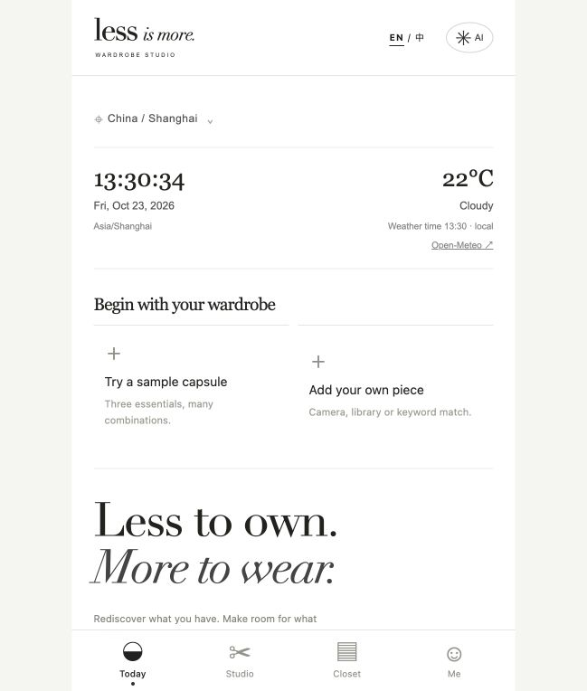
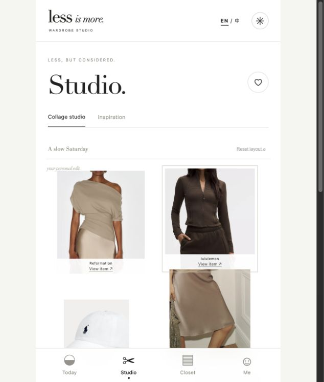
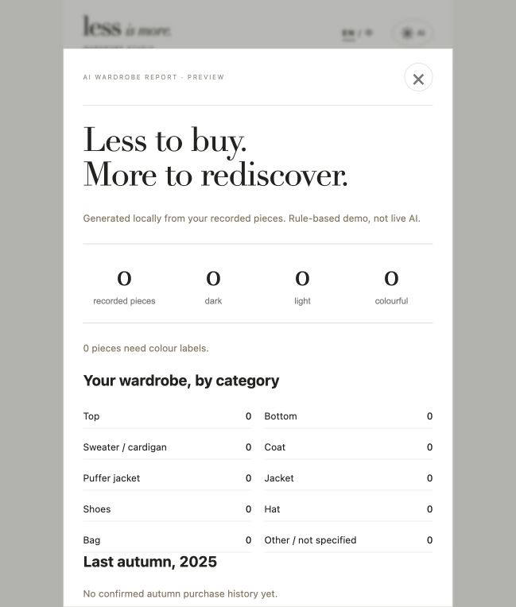

# LESS｜AI循环衣橱与穿搭助手

> 把已有衣物，穿出更多可能。Less is more.

个人产品设计与可交互前端原型 · V3

**[阅读产品案例与体验 Demo](https://less-product-portfolio.yanglinuo37.chatgpt.site/)** · **[直接体验 V3](https://less-wardrobe-v3.yanglinuo37.chatgpt.site/)**

以上托管地址在部分网络环境可能无法访问。也可下载本仓库后，用浏览器打开 `index.html` 阅读案例，或打开 `demo.html` 体验原型。

## 产品问题

面向多品牌购衣、衣橱信息分散的海外年轻时尚用户，探索「衣服不少却不知道怎么搭」「购买前难以判断是否重复」的问题。以纽约为首个设计场景，连接衣橱管理、穿搭灵感、品牌官网和线下试穿的概念路径。

## 我的角色

主导需求定义、产品定位、功能优先级、信息架构、交互与视觉方向、商业化假设和原型验收，借助 AI 辅助完成前端开发与 V1—V3 迭代。

## 核心流程

录入已有衣物 → 获得已有搭配 → 记录穿着 → 衣橱复盘 → 理性补购。

- **Today**：前置拍照、相册与关键词候选录入，展示城市时间和天气。
- **Studio**：服装照片拖拽拼贴、替换、移除、撤销与保存；灵感卡支持左右滑动与「我已有」入柜。
- **Closet**：管理已有衣物、收藏和已保存造型。
- **My / Profile**：个人资料、衣橱结构报告与穿着复盘。

## 界面

| Today | Studio | 衣橱报告 |
| --- | --- | --- |
|  |  |  |

截图中的数据为原型演示资料，不代表用户研究或运营结果。

## 设计取舍

1. 优先验证录入与复用闭环，不将购物设置为完成搭配的前提。
2. 买前提示已有同款或同类，同时允许用户继续探索商品。
3. 从复古拼贴探索收敛至留白和衬线标题，让衣物成为视觉中心。
4. 商业化从免费工具价值出发，再探索高级复盘、导购及预约；合作与付费推荐应明确标识。

## 实现与边界

HTML / CSS / JavaScript，自包含 Demo，用户数据保存在访问者浏览器本地。

| 能力 | 状态 |
| --- | --- |
| 导入、拼贴、收藏、保存、打卡 | 可交互前端 |
| 城市时区与天气 | 时区逻辑 + 联网天气请求 |
| 助手、匹配、推荐与报告 | 本地目录及规则演示，未接在线大模型 |
| 平台支付、库存、留货与核销 | 模拟流程，无真实交易 |
| 品牌入驻与合作 | 商业化假设，未建立真实合作 |

尚无规模化用户、转化或收入数据。后续计划验证首次录入完成率、首套搭配耗时、穿着打卡与买前提醒后的复用比例。

## 项目资料

- [完整项目设计说明](project-design.md)
- [18秒界面截图导览视频](interface-tour.mp4)：非真实操作录屏
- [离线作品包](LESS-V3.zip)

## GitHub Pages

本仓库已包含自动发布工作流。仓库所有者需在 Settings → Pages 中将 Source 设置为 GitHub Actions；推送到 `main` 后会构建并部署静态页面。实际地址以 Pages 返回值为准，国内访问需实测。

## 素材与声明

独立个人概念项目，不代表小红书或品牌官方产品。商品图与商标归各权利方；[素材来源](product-sources.json)。项目未附作者私人衣橱、头像或登录凭据。当前未授予第三方素材的再授权。
